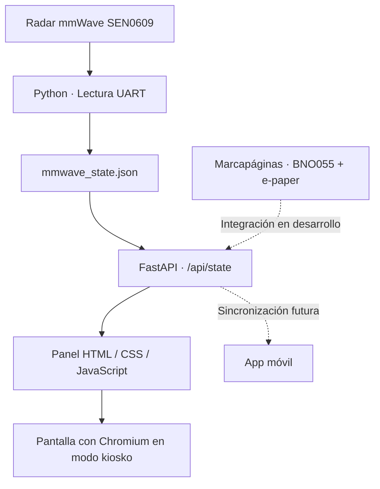

<!-- NEXTpage · WRO 2026 · Bilingual project presentation -->

# NEXTpage

### Tecnología para volver a los libros · Technology that brings us back to books

**World Robot Olympiad 2026 · Future Innovators Senior**  
**Campeones de España / Spanish National Champions**  
**MMM Academy · Alcantarilla, Murcia, España / Spain**

### [🇪🇸 Español](#es) &nbsp; | &nbsp; [🇬🇧 English](#en)

---

## 👥 Equipo NEXT · Meet the team

<strong>Un mismo objetivo, tres especialidades complementarias.</strong> 
<em>One shared goal, three complementary specialities.</em>

 

<table>
  <tr>
    <td align="center" width="33%">
       
      <strong>Blanca Cascales</strong> 
      <strong>Electrónica y programación</strong> 
      <em>Electronics &amp; Programming</em> 
      <small>Sensores, hardware y desarrollo del software.  Sensors, hardware and software development.</small>
    </td>
    <td align="center" width="33%">
       
      <strong>Jimena Martínez</strong> 
      <strong>Diseño y emprendimiento</strong> 
      <em>Design &amp; Entrepreneurship</em> 
      <small>Diseño del producto, identidad visual y modelo de negocio. Product design, visual identity and business model.</small>
    </td>
    <td align="center" width="33%">
       
      <strong>Mario Sánchez</strong> 
      <strong>Comunicación y documentación</strong> 
      <em>Communication &amp; Documentation</em> 
      <small>Documentación técnica y difusión del proyecto. Technical documentation and project communication.</small>
    </td>
  </tr>
</table>

**Mentor / Coach:** José Ángel · **MMM Academy**

[Ir a la versión en español](#es) · [Go to the English version](#en)

---

## 🇪🇸 NEXTpage — Español

### ¿Qué es NEXTpage?

**NEXTpage es un ecosistema de lectura inteligente pensado para animar a los jóvenes a recuperar el hábito de leer libros físicos.** Queremos utilizar la tecnología para acompañar la lectura, no para sustituir el libro por otra pantalla.

El proyecto combina un **marcapáginas inteligente**, una **estación base** y una **aplicación móvil** en desarrollo. Su objetivo es ayudar al lector a conocer sus hábitos, mantener un entorno agradable y hacer que leer resulte más atractivo.

### El problema que queremos resolver

Entre las redes sociales, el entretenimiento digital y las notificaciones constantes, cada vez resulta más difícil encontrar momentos de lectura sin interrupciones. Nuestro reto es crear una solución tecnológica que motive a volver al papel y permita estudiar la experiencia lectora con responsabilidad.

### Los tres componentes

| Componente | Función | Estado |
|---|---|---|
| **Marcapáginas inteligente** | Incorpora un sensor de orientación **BNO055** y una pantalla de tinta electrónica. Permite observar la orientación y los movimientos del libro. | Prototipo funcional; integración con la estación en desarrollo |
| **Estación base** | Utiliza una **Raspberry Pi 5** y un radar **SEN0609** para detectar presencia, distancia y movimiento. Un panel web local visualiza los datos. | Sensor y panel probados en la estación principal; segunda estación de respaldo en preparación |
| **Aplicación móvil** | Está planteada para consultar sesiones, registrar libros, configurar preferencias y recoger la opinión del lector. | Prototipo / desarrollo |

La **carga inalámbrica** y la **música opcional para el modo concentración** forman parte de las integraciones previstas; su implementación no se presenta aquí como finalizada.

  
  

### ¿Cómo funciona la estación base?

La estación principal ya ha utilizado Python para leer tramas del radar por UART y mostrar los datos mediante **FastAPI**. El «nivel de concentración» del prototipo es un **indicador experimental calculado a partir del movimiento**: no mide directamente la concentración, las emociones ni el disfrute de la lectura.

### Documentación y archivos

| Recursos | Acceso |
|---|---|
| Instalación y configuración de la estación base | [Guía en español](./docs/STATION_SETUP.es.md) |
| Organización y mejora del repositorio | [Guía en español](./docs/REPOSITORY_GUIDE.es.md) |
| Informe y documentos del proyecto | [DOCUMENTS](./DOCUMENTS/) |
| Diseños 3D | [3D DESIGN](./3D%20DESIGN/) |
| Esquemas y programación | [ELECTRIC DIAGRAM AND CODING](./ELECTRIC%20%20DIAGRAM%20AND%20CODING/) |
| Fotografías, imágenes y recursos gráficos | [IMAGES](./IMAGES/) |

**Nota técnica:** actualmente existen capturas de código en el repositorio. Iremos incorporando los **archivos fuente originales y probados** del marcapáginas y la estación, además de sus instrucciones de instalación, para que el proyecto pueda reproducirse.

### Nuestro camino a la final internacional

En septiembre de 2026 conseguimos el título de **campeones de España de WRO Future Innovators Senior**. Nuestro siguiente reto es representar a España en la **final internacional de Puerto Rico, del 8 al 10 de diciembre de 2026**.

Nuestro trabajo continúa: estamos documentando el desarrollo, preparando una segunda estación base como repuesto e integrando los diferentes dispositivos del ecosistema.

### Privacidad y rigor

NEXTpage busca apoyar la lectura utilizando sensores de movimiento y presencia, sin necesidad de una cámara para esa tarea. Las conclusiones sobre el bienestar o la motivación lectora requieren **validación y la participación voluntaria del usuario**.

---

## 🇬🇧 NEXTpage — English

### What is NEXTpage?

**NEXTpage is a smart reading ecosystem designed to encourage young people to rediscover printed books.** We want technology to support reading, not replace a physical book with another screen.

Our project brings together a **smart bookmark**, a **home station** and a developing **companion mobile app**. The goal is to help readers understand their reading routines, create a pleasant environment and make reading more engaging.

### The challenge

Social media, digital entertainment and constant notifications can make uninterrupted reading more difficult. We are exploring how technology could help motivate young people to return to printed books while collecting useful information in a responsible way.

### Three connected components

| Component | What it does | Current status |
|---|---|---|
| **Smart bookmark** | Integrates a **BNO055** orientation sensor and an **e-paper display** to observe the book's orientation and movement. | Working prototype; station connectivity in development |
| **Home station** | Uses a **Raspberry Pi 5** and **SEN0609** radar to detect presence, distance and movement. A local web dashboard displays data. | Sensor and dashboard tested on the original station; backup station being prepared |
| **Mobile app** | Intended for reading history, book tracking, preferences and voluntary reader feedback. | Prototype / development |

**Wireless charging** and **optional focus music** are planned integrations; they are not presented as completed features.

### How does the station work?

The diagram above shows the tested pipeline: the SEN0609 sends UART observations to Python; these are stored as JSON and exposed through **FastAPI** to a dashboard shown in Chromium kiosk mode.

The prototype's *focus level* is an **experimental movement-based heuristic**, not a clinically validated measurement of concentration, feelings or reading enjoyment.

### Documentation and project files

| Resources | Open |
|---|---|
| Home station installation and configuration | [English setup guide](./docs/STATION_SETUP.md) |
| Repository audit and safe reorganisation | [English repository guide](./docs/REPOSITORY_GUIDE.md) |
| Reports and project documents | [DOCUMENTS](./DOCUMENTS/) |
| 3D models | [3D DESIGN](./3D%20DESIGN/) |
| Electronics and coding materials | [ELECTRIC DIAGRAM AND CODING](./ELECTRIC%20%20DIAGRAM%20AND%20CODING/) |
| Photos and visual assets | [IMAGES](./IMAGES/) |

**Source-code note:** the repository currently includes screenshots of code. We will add the **original, hardware-tested editable code** for the bookmark and home station with reproducible setup instructions.

### Our journey to the international final

In September 2026, we became **Spanish national champions in WRO Future Innovators Senior**. We are now preparing to represent Spain at the **WRO international final in Puerto Rico, 8–10 December 2026**.

Our next steps include improving technical documentation, replicating the home station as a travel backup and integrating the different parts of the reading ecosystem.

### Privacy and scientific responsibility

NEXTpage aims to help people read using movement and presence sensors, without requiring a camera for this task. Claims about reading motivation or wellbeing would require **further validation and voluntary reader feedback**.

---

**NEXTpage — Tecnología para volver a los libros.**  
*Technology that brings us back to books.*

**Licencia / Licence:** pendiente de definir / not yet selected.

