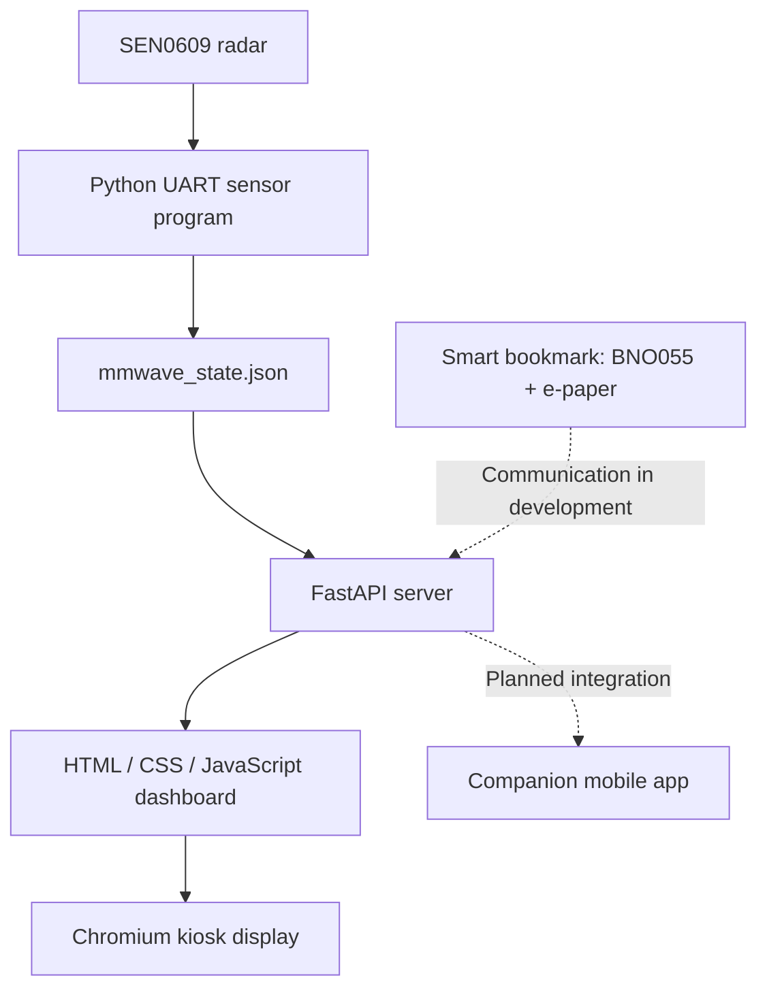

<!-- NEXTpage · World Robot Olympiad 2026 -->

# NEXTpage

### Turn the page. Rediscover reading.

**A smart reading ecosystem connecting printed books, sensor technology and a home station.**

**Team NEXT · MMM Academy · Alcantarilla, Murcia, Spain**  
**WRO 2026 · Future Innovators Senior · Spanish National Champions**

---

## Why NEXTpage?

We wanted to answer a question: **Can we use technology to encourage young people to read physical books?**

NEXTpage is our attempt to bring technology *closer* to reading, instead of replacing the book with another screen. Our prototype combines a smart bookmark, an interactive home station and a companion mobile-app concept.

## The reading ecosystem

| Module | What it does | Status |
|---|---|---|
| **Smart bookmark** | Uses a BNO055 orientation sensor and an e-paper display to support reading detection and feedback | Working prototype; connectivity with the station being developed |
| **Home station** | Raspberry Pi 5 and SEN0609 radar gather presence and movement data and display them in a local visual dashboard | Sensor and dashboard tested on the original station; backup station in progress |
| **Mobile app** | Designed for book tracking, reading history, personalised settings and reader feedback | Prototype / development |
| **Wireless charging & focus music** | Planned additions to make the station more convenient and create an optional reading atmosphere | Integration and testing in progress |

## System architecture

The tested home-station workflow reads SEN0609 UART frames, extracts presence, distance, radial speed and signal energy, generates an experimental movement-based focus score, and serves the state through FastAPI to a browser dashboard.

**Scientific note:** our movement-based *focus level* is an experimental indicator, not a validated measure of concentration, emotions or enjoyment of reading. We plan to combine observations with voluntary reader feedback.

## Documentation and project files

The repository still contains the team's original folders; they are being progressively documented and reorganised. The existing resources are:

- [Project report and documents](./DOCUMENTS/)
- [3D designs and prototypes](./3D%20DESIGN/)
- [Electronics diagrams and coding materials](./ELECTRIC%20%20DIAGRAM%20AND%20CODING/)
- [Images, designs and app concepts](./IMAGES/)
- [Home-station installation guide](./docs/STATION_SETUP.md)
- [Repository audit and reorganisation plan](./docs/REPOSITORY_GUIDE.md)

**Source-code note:** the current coding folder includes screenshots of code. We will add the original editable firmware and Python files after verifying them against the working hardware. Screenshots alone are not sufficient for a reproducible build.

## Hardware and software

| Device | Technology |
|---|---|
| Bookmark | Microcontroller, BNO055, e-paper screen |
| Home station | Raspberry Pi 5, DFRobot SEN0609 / C4001 24 GHz radar, UART |
| Data acquisition | Python, pyserial, JSON |
| Local API and display | FastAPI, Uvicorn, HTML, CSS, JavaScript, Chromium kiosk mode |
| Mobile app | Companion app prototype |

## Team NEXT

**Blanca Cascales · Jimena Martínez · Mario Sánchez**  
**Coach:** José Ángel · **MMM Academy**, Alcantarilla (Spain)

Our team won the Spanish national final in the **Future Innovators Senior** category in September 2026 and is preparing to represent Spain at the international WRO final in Puerto Rico, **8–10 December 2026**.

## Roadmap

- [x] Smart bookmark prototype with BNO055 and e-paper screen
- [x] SEN0609 communication over UART on Raspberry Pi 5
- [x] Python sensor processing and JSON output
- [x] FastAPI dashboard running locally
- [ ] Publish and validate complete editable source code
- [ ] Reproduce the working station on a second Raspberry Pi
- [ ] Integrate bookmark-to-station communication
- [ ] Test wireless charging and optional music controls
- [ ] Integrate the app with real session data
- [ ] Document validation tests and limitations

## Privacy and responsible design

NEXTpage aims to support reading without using a camera for motion detection. Any optional personal data or subjective reader feedback should be handled with consent, transparency and data minimisation.

## Licence

The team has not yet selected a licence for code, designs and media. Public visibility does not imply permission for unrestricted reuse.

---

<strong>NEXTpage — technology that brings us back to books.</strong>

